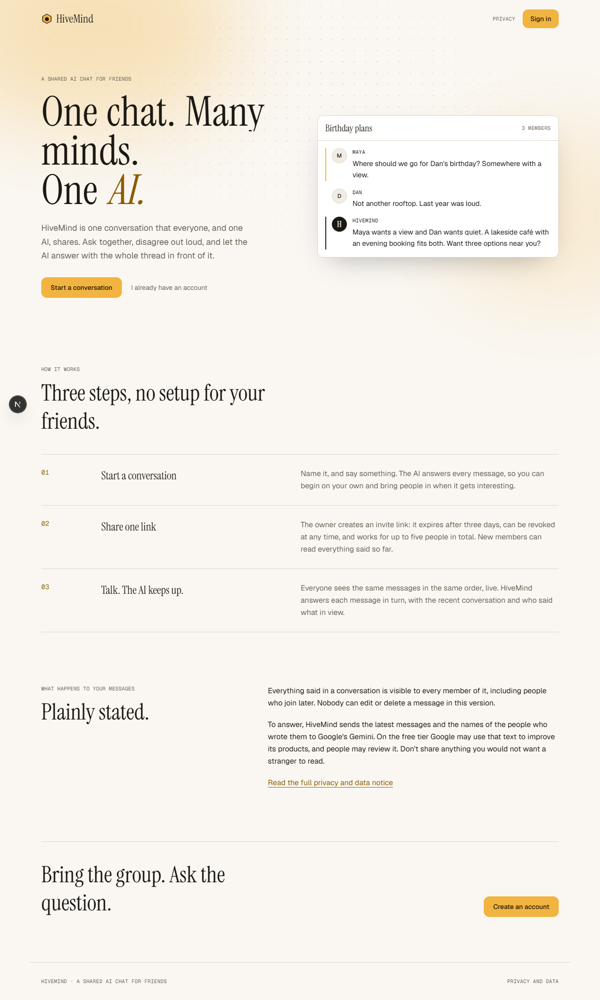
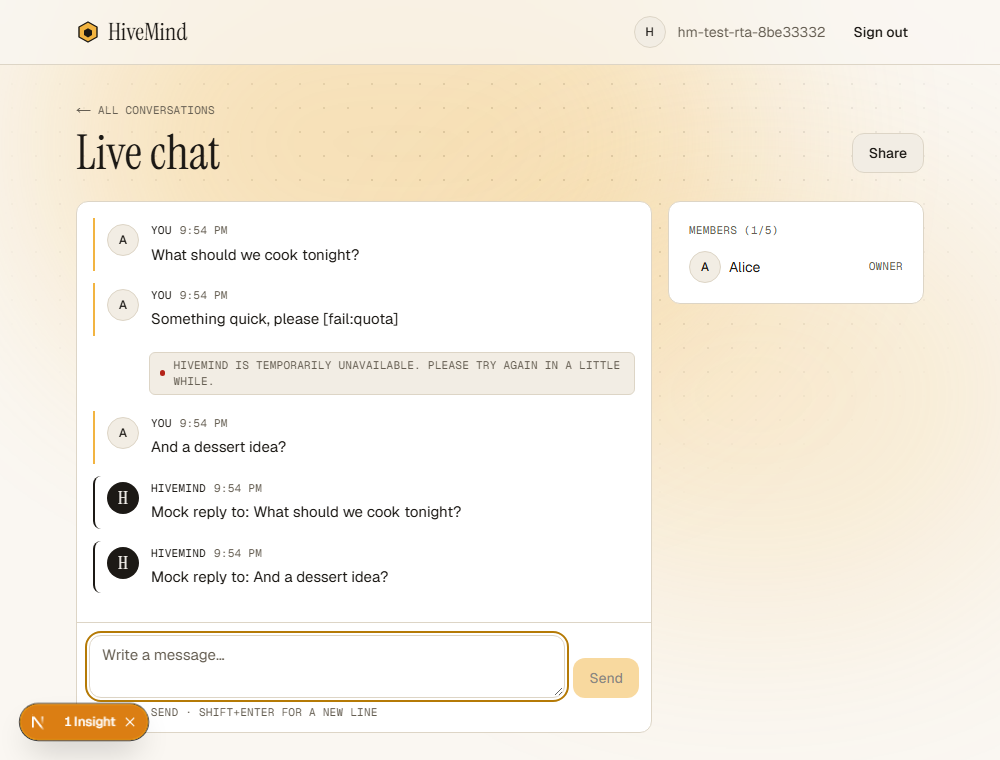
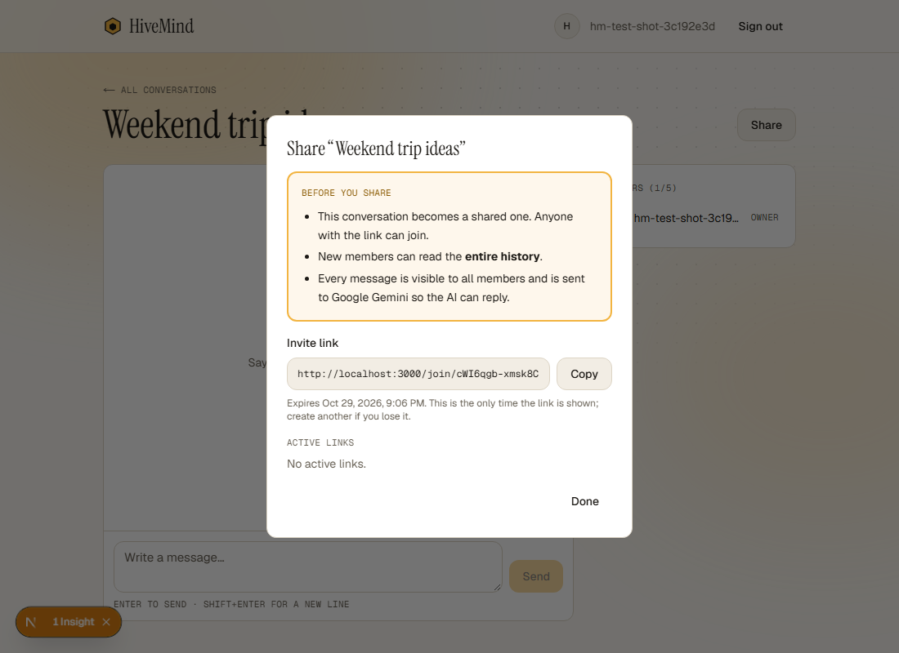
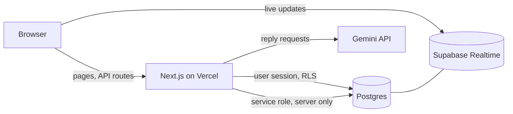

# HiveMind

**One chat. Many minds. One AI.** HiveMind is a shared chat for friends: everyone in a conversation sees the same messages live, and an AI (Google Gemini) answers each message in turn, with the recent conversation and who said what in view.



| The conversation | Sharing it |
|---|---|
|  |  |

## What it does

- **Sign in** with email and password.
- **Start a conversation** and talk to the AI on your own.
- **Share it**: the owner creates an invite link (expires after 3 days, revocable, up to 5 people in total). Joining requires an account, and new members can read the whole history.
- **Live, ordered chat**: messages reach everyone in real time and in one agreed order; a dropped connection catches up on reconnect.
- **One AI reply per message**, answered one at a time per conversation. If the AI fails, the message shows a note with **Retry** (3 attempts at most); a quota error pauses the conversation's AI for a minute.

## How it is built

Next.js 16 (App Router) and TypeScript, Tailwind CSS 4, Supabase (Postgres, Auth, Realtime), Google Gemini through the official `@google/genai` SDK, deployed on Vercel. GSAP and Lenis are used on the public landing and privacy pages only.



The important design choices, each explained in [`docs/architecture.md`](docs/architecture.md):

- **The database is the authority.** Row Level Security decides who can read or write; the app never relies on hiding buttons.
- **A Postgres table is the AI queue.** Every member message creates a job in the same transaction; the database hands each job to exactly one worker and stores at most one reply per job. No separate worker service. See [`docs/decisions/0001-ai-orchestration.md`](docs/decisions/0001-ai-orchestration.md).
- **Invite tokens are stored as hashes** and redeemed atomically with a capacity check.

## Run it yourself

You need Node.js 22 or newer, a free [Supabase](https://supabase.com) project and a [Gemini API key](https://aistudio.google.com/apikey).

```bash
git clone https://github.com/shailkamtikar/HiveMind.git
cd HiveMind
npm install
cp .env.example .env.local        # then fill in the values below
npx supabase login
npx supabase link --project-ref <your-project-ref>
npx supabase db push              # creates the tables, functions and policies
npm run dev                       # http://localhost:3000
```

### Environment variables

| Variable | Needed | Purpose |
|---|---|---|
| `NEXT_PUBLIC_SUPABASE_URL` | yes | Your Supabase project URL |
| `NEXT_PUBLIC_SUPABASE_ANON_KEY` | yes | Public (anon / publishable) key |
| `SUPABASE_SERVICE_ROLE_KEY` | yes | **Secret.** Server only: writes AI replies and rate-limit counters |
| `GEMINI_API_KEY` | yes | **Secret.** Server only |
| `GEMINI_MODEL` | yes | Model id, e.g. `gemini-3.5-flash` |
| `APP_BASE_URL` | yes | Public address of this deployment; invite links are built from it |
| `SUPABASE_DB_PASSWORD` | local only | For `npx supabase db push` from your machine |
| `AI_MODE` | no | `off` stops all AI processing; `mock` (tests only) is ignored in production |
| `MAX_GROUP_MEMBERS`, `MAX_MESSAGE_LENGTH`, `AI_CONTEXT_MESSAGES`, `INVITE_EXPIRY_DAYS`, `MESSAGES_PER_MINUTE`, `AI_CALLS_PER_MINUTE` | no | Limits; defaults 5, 1000, 20, 3, 20, 6 |

Never commit `.env.local`. It is git-ignored; only `.env.example` is tracked.

### Tests

```bash
npm test                  # unit tests
npm run lint
npm run typecheck
npm run dev:test          # leave running in another terminal (test server, AI off)
npm run test:db           # database, API and security tests against your Supabase project
npm run test:e2e          # browser tests (start their own test servers)
npm run test:csp          # production build + real Content-Security-Policy browser test
npm run scan:secrets      # looks for secrets anywhere in git history
```

The database and browser tests create temporary `hm-test-*@example.com` users in the Supabase project from `.env.local` and delete them afterwards. **Use a development project, never your production one.** `RUN_LIVE_AI=1 npm run test:db -- tests/api/ai-live.test.ts` makes one real Gemini call.

## Security and privacy

[`docs/security.md`](docs/security.md) has the threat model, the authorization matrix that is tested table by table, the security headers, the Supabase advisor results and the accepted limitations. In short: Row Level Security on every table, server-only keys, hashed invite tokens, per-user rate limits, a strict Content-Security-Policy in production, and a clean git-history secret scan.

**Privacy:** every member can read the whole conversation, including what was said before they joined. The latest messages and the speakers' names are sent to Google Gemini to produce a reply. On the free Gemini tier Google may use that text to improve its products and people may review it. See the in-app [privacy notice](src/app/privacy/page.tsx).

## Known limitations

- **No deletion.** Messages, conversations and accounts cannot be edited or deleted from inside the app in this version.
- **No demo mode**, and no Google sign-in yet (email and password only).
- **Email is not verified at sign-up**, so anyone can register an address they do not own. Fine for a friends-only app; add verification before a public launch.
- **Free-tier Gemini** can be slow or overloaded and may reuse conversation text (see above). A paid tier removes the data-use caveat and raises limits.
- **The CSP allows inline scripts** (a Next.js requirement until a nonce-based policy is added), and the security headers CSP, frame blocking and Permissions-Policy are sent by production builds only, because they make the Next.js development server reload endlessly.
- **Invite tokens appear in URLs**, so they appear in hosting request logs. They are stored hashed, expire after 3 days and can be revoked.
- **AI replies are plain text**; Markdown is not rendered.
- **Five people per conversation** and 1000-character messages, by design.

## Documentation

| | |
|---|---|
| [`docs/architecture.md`](docs/architecture.md) | How the pieces fit together |
| [`docs/security.md`](docs/security.md) | Threat model and audit results |
| [`docs/deploy.md`](docs/deploy.md) | Deploying to Vercel with a separate production Supabase project |
| [`docs/decisions/0001-ai-orchestration.md`](docs/decisions/0001-ai-orchestration.md) | Why a Postgres queue, with the platform limits checked |
| [`docs/design/design-notes.md`](docs/design/design-notes.md) | Design tokens, motion rules, library licenses |
| [`docs/HiveMind_Development_Playbook.md`](docs/HiveMind_Development_Playbook.md) | The build plan, with a log of every deviation from it |

## Licence

No licence has been granted for now: all rights reserved. The third-party libraries and fonts keep their own licences (see Credits).

## Credits

Fonts: Geist and Geist Mono (SIL Open Font License), Instrument Serif (SIL Open Font License), via `next/font`. Motion: [GSAP](https://gsap.com/standard-license) (GreenSock "no charge" standard license) and [Lenis](https://github.com/darkroomengineering/lenis) (MIT), on the public pages only. The in-app effects are written from scratch in the spirit of [React Bits](https://reactbits.dev); no component source was copied. Details in [`docs/design/design-notes.md`](docs/design/design-notes.md).

