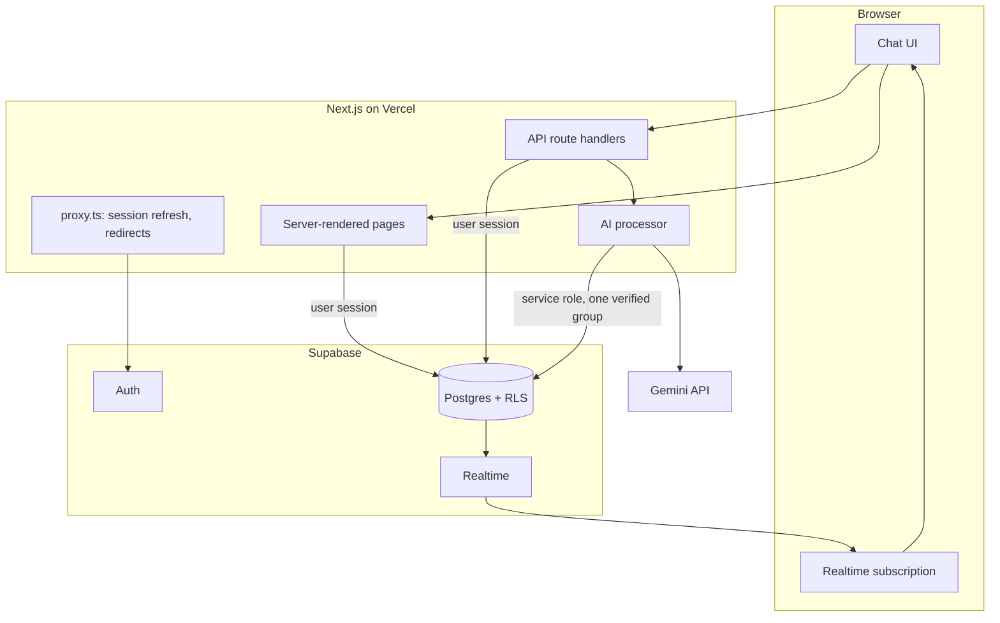

# Architecture

## The pieces

## Data model

`profiles` (display name) - `groups` (a conversation; owner, member limit) - `group_members` - `messages` (append-only, ordered by a database-assigned `seq`) - `invitations` (hashed tokens) - `ai_jobs` (one per member message) - `rate_limits` (counters). Every table has Row Level Security. Clients read through policies and change data only through the routes and `SECURITY DEFINER` functions listed in [`security.md`](security.md).

## Messages: order and delivery

- A message gets its position (`seq`) from the database when it is stored, never from a client clock. Everyone sorts by `seq`.
- The client may supply the message `id`, so a retried send cannot create a duplicate. A member's own messages are sent one at a time, so they are stored in the order they were typed.
- Realtime is only a notification. After any reconnect, coming back online or the tab becoming visible, the client fetches everything after the last `seq` it has (pages of 200), so a missed event can never lose a message. Opening a conversation loads the newest 30 messages; older ones load on demand.

## The AI queue

1. A member sends a message. A database trigger inserts an `ai_jobs` row in the same transaction. The message cannot exist without its job, and a job cannot be created twice for one message.
2. After responding to the sender, the server calls `processGroup(group)`. Browsers also ask `POST /api/groups/[id]/ai/process` on page load and every 20 seconds while a job is waiting, so a dropped request is always recovered.
3. `claim_next_job` (service role only) takes a per-group advisory lock, refuses if a job is already being worked on or the group is cooling down after a quota error, and otherwise marks the oldest queued job `processing`.
4. The processor builds the prompt from the last 20 messages up to and including the trigger, with `Name: text` per line, and calls Gemini with a 25 second timeout (one retry on a 5xx).
5. `complete_job` stores the reply and marks the job `succeeded` in one transaction. A unique index allows one assistant reply per job, so a slow "dead" request finishing late cannot add a second one.
6. Errors become one of `quota | timeout | provider | safety | internal`. The job is marked `failed`; the chat draws a notice from job state (never as an AI message). A quota error also pauses the group for 60 seconds. A member can retry a failed job (`retry_job`, at most 3 attempts).
7. A job stuck in `processing` for more than 90 seconds is handed out again, up to 3 attempts, then marked failed (`timeout`).

One pass works through a group's queue until a 45 second budget is used, then reports `more`; any member's browser starts the next pass. Different groups never block each other.

## Invitations

`create_invitation` (owner only) stores the SHA-256 hash of a random 32-byte token and returns nothing secret; the route shows the link once. `/join/[token]` is a public page; a signed-in browser then sends the token with a POST to `/api/invitations/redeem`, so link previews that only fetch HTML cannot use up an invitation. `redeem_invitation` locks the group row, checks capacity and membership, and answers `joined | already_member | full | invalid`; unknown, expired and revoked links all answer `invalid`.

## Front end

Server components read data with the user's session; interactive parts are small client components. Pages that depend on the signed-in user read it inside `Suspense` boundaries, as Next.js Cache Components requires. Design tokens live in `src/app/globals.css`; motion is CSS-first, with GSAP and Lenis on the public pages only (see [`design/design-notes.md`](design/design-notes.md)).

## Environments

Local development and automated tests use a development Supabase project. Production uses a separate project, so tests never touch real data. See [`deploy.md`](deploy.md).

## Testing layers

| Layer | Where | What it proves |
|---|---|---|
| Unit | `src/**/*.test.ts` | Validation, prompt building, error mapping, headers, config |
| Database | `tests/rls`, `tests/ai`, `tests/security` | RLS, functions, the AI queue (races, recovery, retry), the authorization matrix |
| API | `tests/api` | Route authorization, rate limits, invitations, the live Gemini smoke test (opt in) |
| Browser | `tests/e2e` | Sign-up and sign-in, chat, realtime, reconnect, invites, AI states, landing page; a production build for the CSP |
